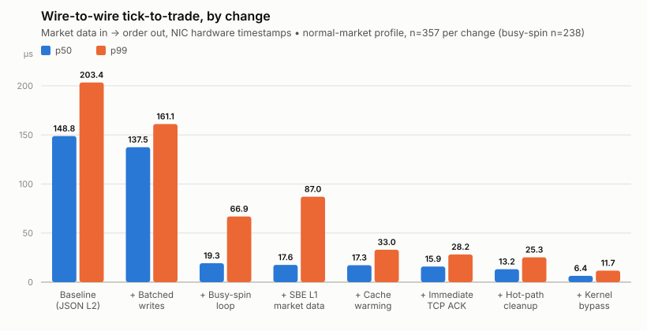

# C++ Low-Latency Trading Engine

Low-latency spot trading engine for OKX V5 in C++20, reaching 6.4 µs p50 and 11.7 µs p99
wire-to-wire tick-to-trade on bare metal (see [Benchmarks](#benchmarks)).

The engine maintains a live L2 order book from an incremental WebSocket feed, runs a
strategy against it, and manages the full order lifecycle — placement, fills, cancellation,
and reconciliation across reconnects, with pre-trade risk limits and a kill switch. It
places, amends and cancels orders over an authenticated WebSocket session, reconciles local
state against the exchange on every reconnect, and halts via a kill switch on a
realised-loss breach.

## Contents

- [Architecture](#architecture)
- [Design](#design)
- [Benchmarks](#benchmarks)
- [Requirements](#requirements)
- [Build](#build)
- [Configuration](#configuration)
- [License](#license)

## Architecture

```
  OKX public WS ─┐
                 ├─ Asio reactor ─ TLS ─ RFC 6455 codec ─ parser ─ order book
  OKX private WS ┘                                           │
                                                             │
                                                             ▼
                                                         strategy
                                                             │
                                             risk checks ────┤
                                                             ▼
                                        order manager ─ WS / REST ─ OKX

  └─ everything from the reactor to the order manager runs on one busy-spinning thread
  └─ log calls go through an SPSC ring to a writer thread, then stdout
```

## Design

In pipeline order (see *Architecture* above):

- **WebSocket framing (RFC 6455)**: the handshake, frame decoding, and masking are
  implemented from the spec. Continuation frames are reassembled into a single
  fixed-capacity buffer that's reused across messages with no reallocation.
- **Receive buffering with in-place parsing**: a purpose-built scanner parses messages directly
  off the receive buffer instead of being copied into a DOM or other intermediate
  representation first.
- **Binary market data (SBE L1)**: a handwritten decoder reads fields at
  fixed byte offsets straight off the wire.
- **Incremental order book (JSON L2)**: a custom order book sequences updates via
  `seqId`/`prevSeqId` and holds them in pre-allocated, fixed-capacity storage.
- **Slabs, ring buffers, SPSC queue**: reactor, parsing, strategy, risk, and order management
  run on one busy-spinning thread. A fixed-capacity ring buffer batches outbound WebSocket
  writes, with every buffer pre-allocated so nothing touches the heap.
- **Order lifecycle, reconciliation, risk**: orders live in a fixed-capacity, slab-allocated
  store and are tracked through a state machine that's reconciled against exchange state on
  every reconnect. Pre-trade checks run before any order placement, and a kill switch cancels
  everything and halts on a realised-loss breach.
- **Per-endpoint rate limiting**: a custom sliding-window limiter checks each endpoint against
  OKX's WS trade-endpoint limits.
- **Measurement**: latency is tracked with its own TSC-timestamped, cycle-accurate histogram
  implementation staged through the whole pipeline.
- **Async logging**: log writes go through a lock-free SPSC ring, synchronised with
  `std::atomic` and explicit C++ memory-model ordering.

A few design choices worth calling out:

- **Asio's scope**: Asio only handles readiness and TLS (`asio::ip::tcp::socket`,
  `asio::ssl::stream`). Framing and message assembly aren't handed off to a library.
- **Buffer ownership**: receive buffers belong to the engine rather than Asio, so messages get
  parsed straight off the read buffer instead of being copied into something else first.
- **Using libraries for some infrastructure**: Boost.Asio provides the reactor loop, OpenSSL
  handles TLS/HMAC-SHA256/base64, and libcurl handles the REST cold path.

## Benchmarks

Benchmarking targets p50 and p99 wire-to-wire tick-to-trade latency, measured on bare-metal
server hardware. Wire-to-wire is defined as the time from a market-data packet arriving at the
NIC to the resulting order packet leaving it, so it covers the network stack, TLS, WebSocket
framing and the engine. The current build reaches 6.4 µs p50 and 11.7 µs p99 in a normal
market, and 6.1 µs p50 and 8.2 µs p99 in a simulated volatile market with bursty, fast-moving
prices.



A few things worth noting about the setup:

- **Engine host**: an Oracle Cloud (OCI) BM.Optimized3.36 bare-metal server (2× Xeon Gold
  6354, ConnectX-6 Dx) running Ubuntu. The engine thread runs on an isolated core, with NIC
  interrupts steered to another core and the CPU governor set to `performance`.
- **Exchange**: `harness/fake_exchange.py` runs on a separate VM and serves market data and the
  order API over TLS WebSockets. It has two profiles: a normal market (120 s, ~1 quoting tick
  per second) and a volatile market (60 s, fast price moves arriving in bursts, ~15 quoting
  ticks per second).
- **NIC timestamps**: a small RDMA sniffer on the engine host copies every packet off the
  network card along with the card's own hardware timestamp. Each market-data tick is then
  paired with the order packet that follows it.
- **Engine timer**: the in-process histogram (socket read return to order bytes queued for the
  socket write) is reported alongside, so engine time can be separated from everything else.
- **Clock**: on x86-64, `perf/clock.hpp` reads the TSC with `rdtsc` and calibrates its
  frequency against `std::chrono::steady_clock` at startup.

| Configuration                    | Engine p50 | Engine p99 | Wire p50 | Wire p99 | Volatile wire p50 | Volatile wire p99 |
|----------------------------------|------------|------------|----------|----------|-------------------|-------------------|
| Baseline                         | 20.7 µs    | 38.9 µs    | 148.8 µs | 203.4 µs | 147.3 µs          | 246.6 µs          |
| + Batched bid/ask into one write | 17.2 µs    | 17.7 µs    | 137.5 µs | 161.1 µs | 135.3 µs          | 154.8 µs          |
| + Busy-spin event loop           | 4.5 µs     | 10.2 µs    | 19.3 µs  | 66.9 µs  | 18.3 µs           | 29.4 µs           |
| + SBE L1 market data             | 3.1 µs     | 4.3 µs     | 17.6 µs  | 87.0 µs  | 16.4 µs           | 26.3 µs           |
| + Cache warming                  | 3.1 µs     | 8.6 µs     | 17.3 µs  | 33.0 µs  | 16.5 µs           | 57.1 µs           |
| + Immediate TCP ACK              | 3.0 µs     | 4.2 µs     | 15.9 µs  | 28.2 µs  | 15.0 µs           | 17.4 µs           |
| + Hot-path cleanup               | 0.79 µs    | 1.8 µs     | 13.2 µs  | 25.3 µs  | 12.4 µs           | 26.8 µs           |
| + Kernel bypass                  | 0.84 µs    | 1.8 µs     | 6.4 µs   | 11.7 µs  | 6.1 µs            | 8.2 µs            |

Normal-market wire numbers are pooled over three runs (n=357 ticks, n=238 for busy-spin), and
volatile numbers come from one run (n=871). Engine numbers come from the volatile run (n=1,742
orders). At these sample sizes p99 is roughly the 4th-worst tick, so the middle rows' p99s move
between runs (SBE's ranged from 49 µs to 87 µs), while p50s are stable.

Seven changes got wire p50 numbers down by ~23x:

- **Batched writes**: bid and ask amend requests go out in one socket `write()` instead of two
  separate calls, so the second no longer queues behind the first's still-in-flight send.
- **Busy-spin**: the event loop polls instead of sleeping on `epoll` so a tick never waits
  for the thread to wake up.
- **SBE market data**: replacing JSON L2 book parsing with OKX's binary SBE L1 feed.
- **Cache warming**: between ticks, the pipeline from market data to frame encoding runs on
  dummy input, and the order connection sends a WebSocket ping every 20 ms. This keeps code,
  data and the TLS/TCP send path warm.
- **Immediate TCP ACK**: `TCP_QUICKACK` is set after each read, so ACKs go out straight away
  instead of waiting on the kernel's delayed-ACK timer.
- **Hot-path cleanup**: a cheaper random number generator, a reused string buffer and
  hand-written price formatting.
- **Kernel bypass**: NVIDIA XLIO is loaded with `LD_PRELOAD` and handles socket calls in user
  space, with the network card writing straight into process memory.

### Host tuning

Each tuning setting was turned off one at a time on the kernel network stack to see what it
was worth (normal market, three runs, n=357).

| Setting removed                       | Wire p50 | Wire p99 |
|---------------------------------------|----------|----------|
| None (all tuning on)                  | 13.1 µs  | 20.7 µs  |
| NIC interrupts steered off the engine | 15.3 µs  | 106.1 µs |
| `performance` CPU governor            | 20.9 µs  | 54.1 µs  |
| Engine pinned to an isolated core     | 16.6 µs  | 28.4 µs  |
| Connection-tracking bypass            | 13.3 µs  | 20.8 µs  |

The first row is the same build as `Hot-path cleanup` above. Its p99 differs from the table
above due to run-to-run noise.

### Reverted optimisations

There were some changes that looked promising but did not hold up under measurement:

- **Single-pass JSON field scan**: collapsed four separate scans of the book-update payload
  (`seqId`, `prevSeqId`, `bids`, `asks`) into one. This was verified to be faster in
  isolation, but there was no measurable change end-to-end, as OKX's payload sizes (a few
  hundred bytes) were too small to make scanning the bottleneck.
- **Custom JSON key search and fixed-decimal parser**: written to replace
  `std::format`/`strtod`. 3.5-7x faster per call in an isolated microbenchmark, but there
  were no measurable tick-to-trade differences.
- **Darwin real-time scheduling policy** (`THREAD_TIME_CONSTRAINT_POLICY`): this was stacked
  on top of the busy-spin loop but no measurable effect was detected.
- **Logger writer thread pinned to background QoS**: no measurable impact was seen.
- **Linux kernel tuning on cloud VMs**: kernel busy-polling (`net.core.busy_poll`) and LTO
  made no measurable difference to wire latency, while receive interrupts on the engine's core
  and synchronous socket writes made p99 worse.

### Stage-by-stage breakdown

| Stage               | p50    | p99      |
|---------------------|--------|----------|
| WS decode           | 51 ns  | 64 ns    |
| Book update         | 28 ns  | 51 ns    |
| Order lookup        | 427 ns | 543 ns   |
| Rate limit check    | 28 ns  | 60 ns    |
| Price format        | 31 ns  | 68 ns    |
| Message build       | 155 ns | 193 ns   |
| Send (encode+write) | 403 ns | 551 ns   |
| Total               | 839 ns | 1,759 ns |

A few things worth noting about this table:

- **Configuration**: these are from the kernel bypass build during the volatile profile
  (n=1,742 orders).
- **Stage boundaries**: `perf::ReadCounter()` checkpoints are threaded through the pipeline,
  so each stage gets its own histogram rather than one combined statistic. This is why stage
  percentiles don't sum to the total's.

### Reproducing

The benchmarks need two Linux hosts on the same subnet: an engine host with an NVIDIA ConnectX NIC,
and an exchange host for the harness that the engine host can reach over SSH.

1. On the exchange host, install the harness and generate its TLS certificates:

   ```sh
   harness/setup_exchange.sh
   ```

2. On the engine host, copy `harness/certs/ca.crt` over from the exchange host, point OKX's
   hostnames at the exchange, isolate the engine core and reboot:

   ```sh
   harness/setup_engine.sh <exchange_ip>
   harness/isolate_cores.sh 4
   sudo reboot
   ```

3. After each boot, tune the engine host, then build the engine and XLIO:

   ```sh
   harness/tune_host.sh <interface> 2 <exchange_ip>
   cmake --preset release && cmake --build --preset release
   harness/build_xlio.sh
   ```

4. Run a profile from the engine host, with `--xlio` for kernel bypass. Each run saves the
   capture and logs to the output directory and prints the paired tick-to-trade percentiles:

   ```sh
   export EXCHANGE=<user@exchange_host> INTERFACE=<interface>
   harness/run_bench.sh normal /tmp/bench/normal-1
   harness/run_bench.sh volatile /tmp/bench/volatile-1 --xlio
   ```

Cores 4 (engine), 2 (NIC interrupts), 6 (logger) and 1 (sniffer) are the ones used on the
benchmark host, all on the NIC's NUMA node.

## Requirements

Developed on macOS (Apple Silicon) with the following prerequisites:

- macOS 14+, arm64, Xcode Command Line Tools (Apple clang 17+ / C++20)
- CMake 3.20+, Ninja
- OpenSSL 3, Boost
- System `libcurl`

Benchmarks run on Linux x86-64 (Ubuntu), which needs:

- GCC 13+ (for `std::format`), CMake 3.20+, Ninja
- OpenSSL 3, Boost, libcurl
- `libibverbs-dev` and an NVIDIA ConnectX NIC for the sniffer and kernel bypass

```sh
sudo apt-get install build-essential cmake ninja-build libssl-dev libboost-dev \
    libcurl4-openssl-dev libibverbs-dev
```

## Build

```sh
cmake --preset release   # or: debug, asan
cmake --build --preset release
```

Formatting is enforced by a pre-commit hook. `core.hooksPath` is per-clone config, so enable
it once after cloning:

```sh
git config core.hooksPath .githooks
```

The hook rejects commits whose staged C++ files aren't clang-format clean.

- `cmake --build <dir> --target format` fixes the whole tree.
- `cmake --build <dir> --target format-check` reports without rewriting.

## Configuration

Add credentials as environment variables.

```sh
export OKX_API_KEY=...
export OKX_API_SECRET=...
export OKX_PASSPHRASE=...
export OKX_MARKET_DATA_MODE=json   # or: sbe
```

## License

MIT.
